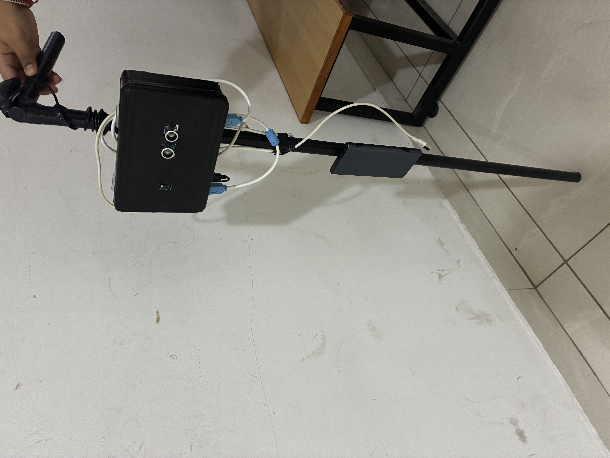

# AI-Enabled Blind Assistance Stick

An AI-powered assistive device designed to help visually impaired people navigate their surroundings independently using computer vision, voice assistance, and obstacle detection.

## Features

- Real-time object detection using YOLOv8
- Obstacle detection using an ultrasonic sensor
- Voice-based assistance
- Text recognition using OCR
- Text-to-speech feedback
- GPS-based location tracking
- Emergency SMS alerts
- Arduino-based vibration alerts

## Technologies Used

Python, YOLOv8, OpenCV, Raspberry Pi, Arduino Uno, HC-SR04 ultrasonic sensor, GPS module, EasyOCR, gTTS and SpeechRecognition.

## Project Structure

```text
AI-Smart-Stick/
├── software/
│   ├── arduino.py
│   ├── emergency_alert.py
│   ├── gps_module.py
│   ├── main.py
│   ├── nlp.py
│   ├── object_detection.py
│   ├── text_reader.py
│   ├── tts_module.py
│   └── voice_command.py
└── .gitignore
```

The repository-level `requirements.txt` is in the parent directory.

## Installation

From the repository root, install dependencies:

```bash
pip install -r requirements.txt
```

Download the YOLOv8 model weights required by the object-detection module and place them at the path expected by the code. Configure the Arduino, GPS module, camera and other hardware components before running the application.

## Hardware Requirements

- Raspberry Pi 4
- Arduino Uno
- Pi Camera
- HC-SR04 Ultrasonic Sensor
- GPS Module
- Vibration Motor
- Buzzer
- Earphones

## Project Screenshots

### Hardware Setup


### Project Overview


### Circuit Diagram


## Research Paper

**DRISHTANT: AI Enabled Blind Assistance Stick**

[Read the research paper](../drishtant_research_paper.pdf)

## Security and Limitations

Keep Twilio credentials, API keys and personal phone numbers in a local `.env` file. Do not commit secrets. Emergency SMS requires network access and valid Twilio credentials; it is not an offline feature.

## Author

Developed as an academic AI and Data Science project.
