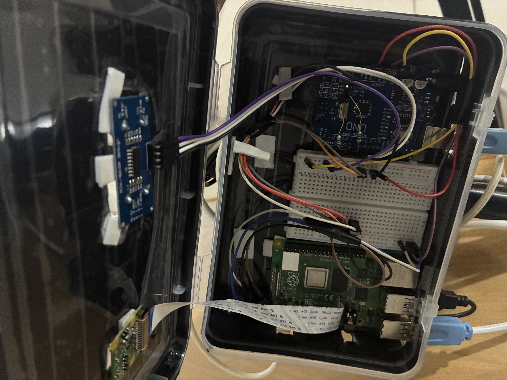

# AI-Enabled Blind Assistance Stick

An AI-powered assistive device designed to help visually impaired people navigate their surroundings independently using computer vision, voice assistance, and obstacle detection.

## Features

- Real-time object detection using YOLOv8
- Obstacle detection using an ultrasonic sensor
- Voice-based assistance
- Text recognition using OCR
- Text-to-speech feedback
- GPS-based location tracking
- Emergency SMS alerts
- Arduino-based vibration alerts

## Technologies Used

- Python
- YOLOv8
- OpenCV
- Raspberry Pi
- Arduino Uno
- Ultrasonic Sensor
- GPS Module
- EasyOCR
- gTTS
- Speech Recognition

## Project Structure

```text
AI-Smart-Stick/
├── docs/
├── models/
│   ├── object_detection/
│   └── ocr/
├── software/
│   ├── arduino.py
│   ├── emergency_alert.py
│   ├── gps_module.py
│   ├── main.py
│   ├── nlp.py
│   ├── object_detection.py
│   ├── text_reader.py
│   ├── tts_module.py
│   └── voice_command.py
├── .gitignore
├── requirements.txt
└── README.md
```

## Installation

1. Clone this repository.
2. Install the required Python packages:

```bash
pip install -r requirements.txt
```

3. Download the YOLOv8 model weights required by the project and place them in the expected location.
4. Configure the Arduino, GPS module, camera, and other hardware components.
5. Configure the required API credentials for emergency SMS functionality.

## Hardware Requirements

- Raspberry Pi 4
- Arduino Uno
- Pi Camera
- HC-SR04 Ultrasonic Sensor
- GPS Module
- Vibration Motor
- Buzzer
- Earphones

## Project Objective

To develop an affordable, portable, and intelligent assistive device that supports independent mobility and improves accessibility for visually impaired individuals.

## Project Screenshots

### Hardware Setup


### Project Overview


### Circuit Diagram


## Research Paper

**DRISHTANT: AI Enabled Blind Assistance Stick**

This research paper presents the system architecture,
methodology, hardware integration, AI-based object detection,
and experimental evaluation of the proposed assistive device.

[Read the Research Paper](research_paper/DRISHTANT_Research_Paper.pdf)


## Author

Developed as an academic AI and Data Science project.
