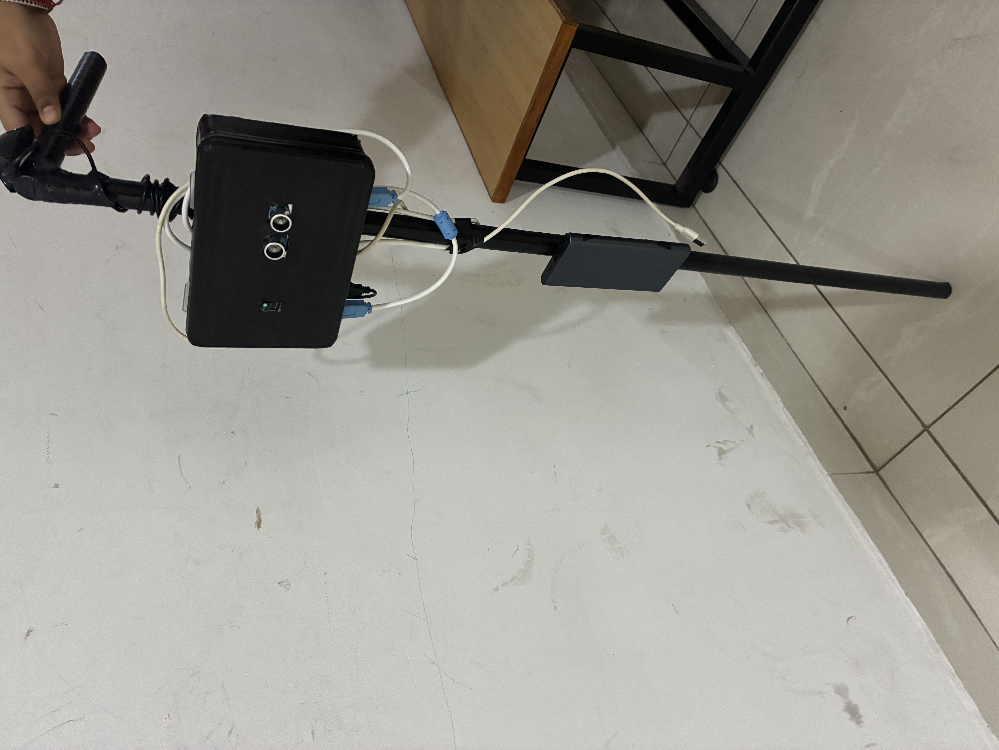

# DRISHTANT — AI-Enabled Blind Assistance Stick

An AI-powered assistive prototype designed to support visually impaired people with environmental awareness and navigation assistance through computer vision, obstacle sensing, voice interaction and location-based emergency alerts.

## Project highlights

- Real-time object detection using YOLOv8
- Obstacle distance sensing using an HC-SR04 ultrasonic sensor
- Voice command interaction and spoken feedback
- Text recognition (OCR) for reading visible text
- GPS-based location tracking
- Emergency SMS alert functionality
- Arduino-controlled vibration and buzzer feedback

## Hardware

- Raspberry Pi 4
- Arduino Uno
- Raspberry Pi Camera
- HC-SR04 ultrasonic sensor
- GPS module
- Vibration motor and buzzer
- Earphones and portable power bank

## Technology stack

Python, YOLOv8, OpenCV, EasyOCR, SpeechRecognition, text-to-speech libraries, Raspberry Pi and Arduino.

## Repository contents

- `AI-Smart-Stick/software/` — Python modules for the device
- `screenshots/` — project overview, hardware setup and circuit diagram
- `requirements.txt` — Python dependencies
- `drishtant_research_paper.pdf` — project research paper

For the detailed software structure and setup instructions, see the [software README](AI-Smart-Stick/README.md).

## Research paper

[Read DRISHTANT: AI-Enabled Blind Assistance Stick](drishtant_research_paper.pdf)

## Setup

1. Clone this repository.
2. Install the Python dependencies with `pip install -r requirements.txt`.
3. Configure the Raspberry Pi, camera, Arduino, ultrasonic sensor and GPS module.
4. Download the YOLOv8 weights required by the object-detection module and place them at the path expected by the code.
5. Configure credentials for emergency SMS in a local `.env` file. Never commit API keys, authentication tokens or personal phone numbers.
6. Follow the module and hardware configuration details in [AI-Smart-Stick/README.md](AI-Smart-Stick/README.md).

**Note:** This is an academic prototype, not a certified mobility or safety device. GPS and emergency SMS features depend on suitable hardware, network availability and valid service credentials. The YOLO model weights are not included in this repository.

## Author

**Madhushree V**  
[GitHub profile](https://github.com/Madhugowda2204)
